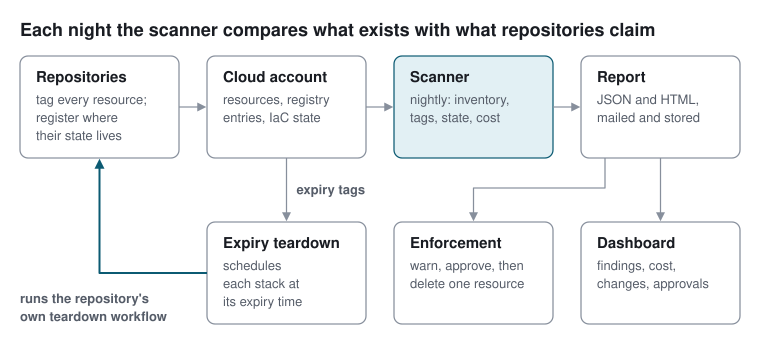
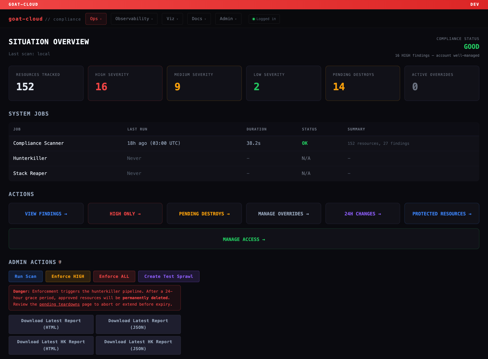
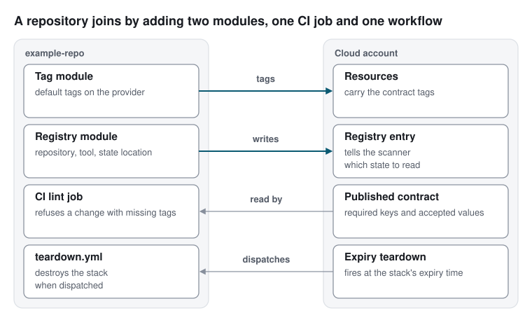
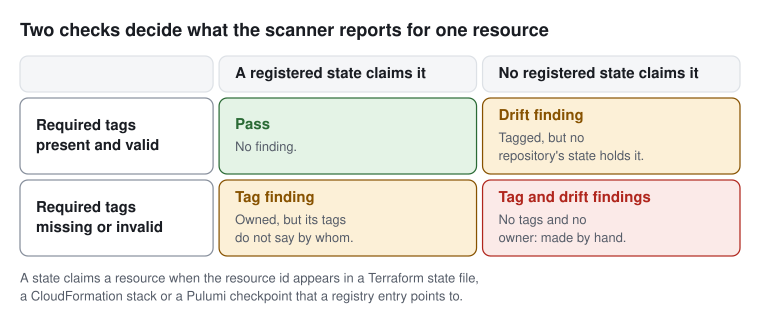
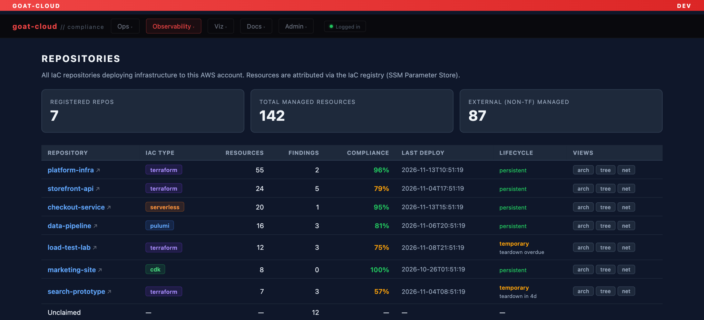
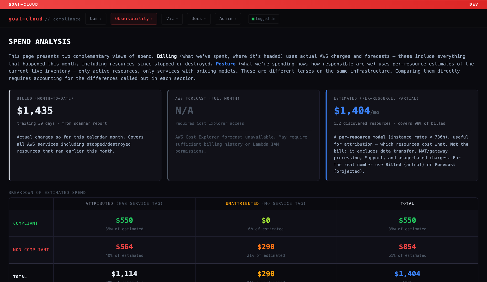
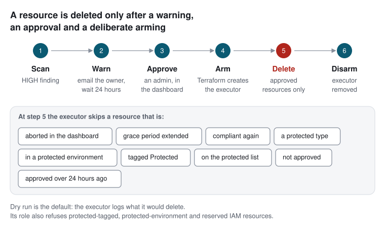
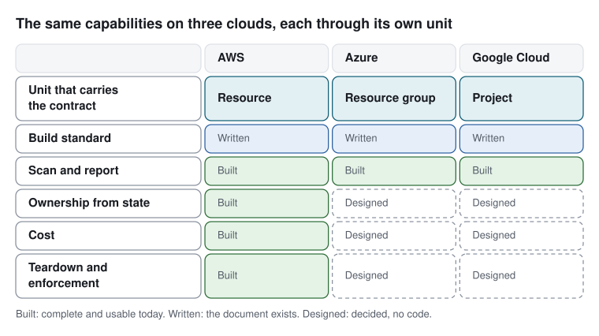

# goat-cloud

goat-cloud keeps a cloud environment in a state where every resource has an owner, a purpose and a lifetime that anyone can look up. Developers deploy from their own repositories with no central gate and no ticket. What has no owner, or has outlived its stated expiry, is found each night, its owner is warned, and it is removed. The cost of the environment stays explainable because nothing in it is anonymous.

**Status.** AWS: demonstrated and stable. Every part described on this page is built and has run each night in a production account, and the AWS modules are the ones to adopt today. Azure and Google Cloud: new. Their build standards, reference roots and read-only scan are built and have each been run once against a live subscription and a live project; the remaining capabilities are designed, not built, and their interfaces may change between releases.

It does this with four small parts: a contract of tags that each repository applies in its own code, a registry in which each repository records where its infrastructure state lives, a nightly scan that compares what exists with what the repositories claim, and removal that runs only behind a warning, an approval and a deliberate switch.





The screenshot is the dashboard running on this repository's synthetic demo data. To see it on your machine, with no cloud account:

```sh
git clone https://github.com/USAREUR-AF/goat-cloud
cd goat-cloud
pip install boto3            # imported by the dashboard code; the demo makes no AWS call
python3 demo/serve.py        # http://localhost:8888
```

To get a first report from your own AWS account, follow [docs/quickstart-aws.md](docs/quickstart-aws.md). It deploys the scanner with Terraform, runs one scan, and downloads the report.

## What you get

An environment run this way has three properties. Each comes from specific parts of this repository.

### Engineered: ownership is written in code

Every repository states, in its own infrastructure code, what it owns and for how long. Nothing is entered in a console or a spreadsheet, and no central team edits a list when a repository joins.

| Part | What it does |
|---|---|
| The contract | Six facts on every resource: project, environment, managing tool, lifecycle, repository, and an expiry when the resource is not meant to last. One module turns them into the provider's default tags |
| The registry | One entry per repository: its URL, its tool, where its state lives. Written by the repository's own deployment |
| CI lint | Fails a change that would deploy without the contract's tags |
| Build standard | Numbered rules a repository follows, each with how it is checked: [AWS](docs/build-standard-aws.md), [Azure](docs/build-standard-azure.md), [Google Cloud](docs/build-standard-gcp.md) |

Terraform, OpenTofu, Pulumi, CloudFormation, the Serverless Framework, CDK, SAM and Copilot repositories take part on equal terms. A team keeps the tool it has.



### Observable: anyone can see what exists, who owns it and what it costs

The scanner reads infrastructure state where it already lives and compares it with the account. Nothing is installed on a host and no deployment pipeline changes.



| Part | What it shows |
|---|---|
| The report | Every resource, every finding, and estimated cost per resource, as JSON, Markdown and HTML, each night |
| The dashboard | Findings, changes since yesterday, repositories and their resources, cost, the state tree, a network graph, protected resources, pending approvals |
| Cost | A monthly estimate per resource, the total cost of everything with a finding, billed spend per service, and budget alerts at 50, 80, 100 and 120 percent of a limit |





### Regulated: what should not exist is removed, behind gates

A resource that is unowned or expired does not stay because nobody got to it. Its owner is told, a period passes, and it goes. Removal is the part with the most safeguards.

| Part | What it does |
|---|---|
| Expiry | A temporary or experimental resource states when it ends. At that time the owning repository's own teardown workflow is dispatched, so the tool that created the stack removes it |
| Enforcement | A single resource with a serious finding: a warning to its owner, 24 hours, an administrator's approval, then deletion by an executor that does not exist until an administrator creates it |
| Gates | Dry run by default. Protected types, protected environments, a `Protected` tag and a protected list each stop a deletion in the executor's code. Its role allows deletes on EC2, RDS, ECS, Lambda, ElastiCache and load balancers only for resources that are not tagged `Protected` and not in a protected environment |



## Cloud support

The three clouds get the same capabilities, each through its own unit and its own mechanism. On AWS the contract attaches to each resource. On Azure it attaches to the resource group, and on Google Cloud to the project; that unit carries the contract and is removed as a whole.

| | AWS | Azure | Google Cloud |
|---|---|---|---|
| Maturity | Demonstrated and stable: runs nightly in production | New: run once live, may change | New: run once live, may change |
| Unit the contract attaches to | resource (tags) | resource group (tags) | project (labels) |
| Build standard with a reference root | Written; in use in production | Written; reference root applied and destroyed once | Written; reference root applied and destroyed once |
| Read-only scan and report | Built: nightly scanner | Built: `python -m goatcloud scan`, checked against a live subscription | Built: `python -m goatcloud scan`, checked against a live project |
| Ownership from registered state | Built | Designed | Designed |
| Cost | Built | Designed | Designed |
| Expiry teardown | Built | Designed | Designed |
| Enforcement with approval | Built | Designed | Designed |
| Dashboard | Built | Designed | Designed |

Built means the code is complete and usable today. Written means the document or code exists. Designed means the approach is decided and no code exists. [docs/cloud-parity.md](docs/cloud-parity.md) lists every capability with its mechanism on each cloud and the compensating step where a cloud's mechanism is weaker.



## Scope and non-goals

goat-cloud governs what shares one account, subscription or project: who owns each thing in it and whether it should still exist. It leaves the following to tools built for them.

| Not in goat-cloud | Use |
|---|---|
| A different policy rule for each resource type | [Cloud Custodian](https://cloudcustodian.io), or the cloud's own policy service. goat-cloud has one contract and no rule language |
| Refusing an untagged resource at creation | AWS Organizations tag policies, which can also check Terraform, CloudFormation and Pulumi changes for required tags before deployment; Azure Policy (`Require a tag on resources`, `Inherit a tag from the resource group`); Google Cloud organization policy custom constraints. goat-cloud detects after creation. Rendering the contract into these controls is planned |
| Cost anomaly detection | AWS Cost Anomaly Detection, anomaly alerts in Microsoft Cost Management, anomaly detection in Google Cloud Billing |
| Commitment and rate optimization, chargeback, unit economics, cost estimates in pull requests | A FinOps tool. goat-cloud answers "whose is this and should it exist", which those tools assume is already known |
| Isolation between workloads | Separate accounts, subscriptions or projects, following each provider's landing-zone guidance. Put production in its own account when you can |
| Differences between a repository's code and its deployed resources | `terraform plan`, or CloudFormation drift detection. goat-cloud reports resources that no state claims; it does not compare a claimed resource with its definition |

## Parts

| Part | Module or path | What it does |
|---|---|---|
| Tag contract | `modules/aws/compliance-tags` | Produces the required tags for `provider "aws" { default_tags }` |
| Registry | `modules/aws/iac-registry` | Writes one entry per repository: its URL, its tool, where its state lives |
| Scanner | `modules/aws/compliance-scanner` | Nightly Lambda: inventory, four checks, cost estimates, JSON, Markdown and HTML reports |
| Enforcement notifier and executor | `modules/aws/hunterkiller` | Warns owners, records approvals, deletes approved resources when armed |
| Expiry teardown | `modules/aws/stack-reaper` | Schedules each temporary stack at its expiry time and dispatches the repository's `teardown.yml` |
| Budget and stale-resource alerts | `modules/aws/governance` | Monthly budget with four thresholds, weekly lifecycle check, one alert topic |
| Dashboard | `modules/aws/compliance-dashboard` | Web views of findings, cost, changes, repositories, state tree, network graph, protected resources and pending approvals |
| CI lint | `scripts/compliance-lint` | Checks a repository's IaC for the required tags before it deploys |
| Scan and report for Azure and Google Cloud | `goatcloud/` | `python -m goatcloud scan`: lists a subscription or project, grades it against the contract, writes a report |
| Demo | `demo/` | Synthetic estate and a local runner for the dashboard |

## Documentation

| To do this | Read |
|---|---|
| Understand the contract, the registry, findings, gates and cost | [docs/concepts.md](docs/concepts.md) |
| Get a first report from an AWS account | [docs/quickstart-aws.md](docs/quickstart-aws.md) |
| Build a repository to the standard | [AWS](docs/build-standard-aws.md), [Azure](docs/build-standard-azure.md), [Google Cloud](docs/build-standard-gcp.md) |
| Bring an existing repository under the contract | [docs/guides/onboard-a-repository.md](docs/guides/onboard-a-repository.md) |
| Read a report and use the dashboard | [docs/guides/read-a-report.md](docs/guides/read-a-report.md) |
| Turn on deletion safely | [docs/guides/arm-enforcement.md](docs/guides/arm-enforcement.md) |
| Have a temporary stack removed at its expiry | [docs/guides/expiry-teardown.md](docs/guides/expiry-teardown.md) |
| Scan an Azure subscription or a Google Cloud project | [docs/guides/add-a-cloud.md](docs/guides/add-a-cloud.md) |
| Compare the clouds capability by capability | [docs/cloud-parity.md](docs/cloud-parity.md) |
| Look up a tag, a report field or a module input | [docs/reference/](docs/reference/) |

## License

Apache-2.0. See [LICENSE](LICENSE).
