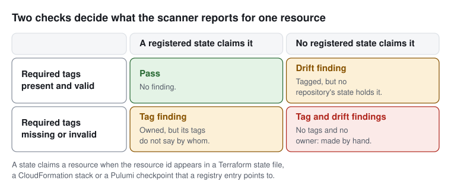
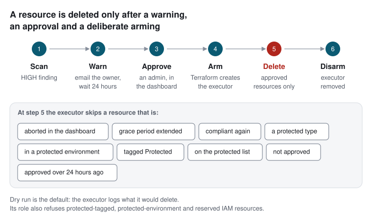
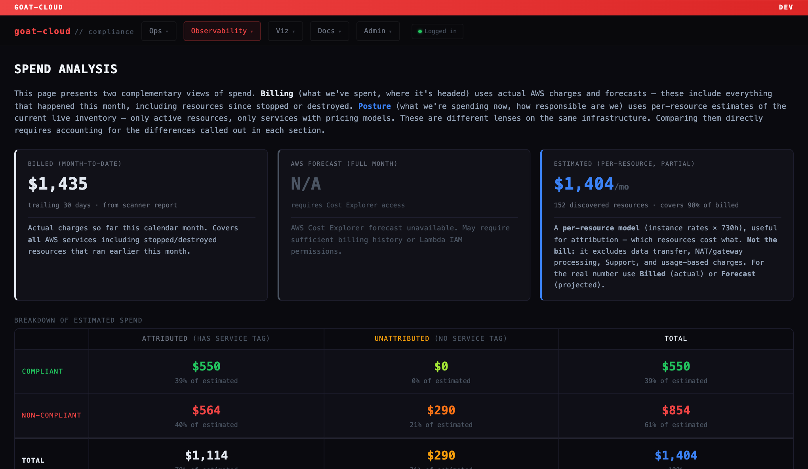

# Concepts

A cloud environment stays fast to work in and affordable to run when three things hold: every resource states who owns it and how long it should exist, anyone can see what exists and what it costs, and what is unowned or expired is removed. Without the first two, cost control becomes a search for owners; without the third, the search never ends.

goat-cloud is built to make those three hold. This page defines its ideas in that order and names the code behind each.

The **platform root** is the Terraform root that deploys goat-cloud's modules (scanner, dashboard, enforcement) into an account; [quickstart-aws.md](quickstart-aws.md) creates one. Every other repository only tags its resources and registers itself.

| Property | Ideas on this page |
|---|---|
| Engineered: ownership is declared in each repository's code | [the contract](#the-contract), [the unit it attaches to](#the-unit-the-contract-attaches-to), [the registry entry](#the-registry-entry) |
| Observable: what exists, whose it is and what it costs can be looked up | [ownership from state](#ownership-from-state-and-how-unclaimed-resources-are-found), [what reading your state means](#what-reading-your-state-means), [findings](#findings), [how findings are kept correct](#how-findings-are-kept-correct), [three-state cost](#three-state-cost) |
| Regulated: what should not exist is removed, behind gates | [enforcement gates](#enforcement-gates) |

## The contract

The contract is the short list of facts every cloud resource states about itself. On AWS and Azure a fact is a tag; on Google Cloud it is a label.

| Fact | Required | Accepted values | AWS and Azure tag | Google Cloud label |
|---|---|---|---|---|
| project | yes | any | `Project` | `workload` (`project` would read as the Google Cloud project) |
| environment | yes | any | `Environment` | `environment` |
| managed by | yes | `terraform`, `opentofu`, `pulumi`, `serverless`, `cdk`, `cloudformation`, `sam`, `copilot`, `bicep`, `arm`, `infrastructure-manager`, `ansible`, `helm`, `manual`, compared without regard to case | `ManagedBy` | `managed-by` |
| lifecycle | yes | `persistent`, `temporary`, `experiment`, `deprecated` | `Lifecycle` | `lifecycle` |
| repository | yes, except on Google Cloud | a URL that starts with `https://` or `git@` | `Repository` | not a label; the registry entry carries it |
| expiry | when lifecycle is `temporary` or `experiment` | a UTC timestamp | `ExpiresAt`, ISO 8601 | `expires-at`, as `20301201t0000z` |
| owner | on Google Cloud only | a team or a role, never a person | `Owner` | `owner` |
| contact | no | a team address or a channel, never a person's address | `Contact` | not a label; the registry entry carries it |
| protected | no | `true` | `Protected` | `protected` |
| schedule | no | any | `Schedule` | `schedule` |
| cost center | no | any | `CostCenter` | `cost-center` |

Google Cloud label values allow only lowercase letters, digits, `_` and `-`, up to 63 characters. A URL or an ISO 8601 timestamp cannot be a label value, so the expiry has a compact form there, the repository URL and the contact live in the registry entry, and `owner` is required in place of `repository`.

Three more tags are optional on AWS and make findings easier to act on: `Service` (which system the resource belongs to), `Subcomponent` (its role in that system) and `Purpose` (one plain sentence). The dashboard groups by `Service`, and the cost view reports spend with and without it.

A deployment that already labels its resources under other key names keeps them: a mapping file names, for each fact, the key that deployment uses, and may change which facts are required. A deployment whose projects carry `app` and `stage` maps `project` to `app` and `environment` to `stage`, and the scan grades those keys. [reference/tag-contract.md](reference/tag-contract.md#deployment-mapping) has the format.

The Terraform module `modules/aws/compliance-tags` turns five inputs into the tag map for `provider "aws" { default_tags }` and reports a failed check on every plan in which a temporary resource has no expiry. The scanner checks the same keys on every resource it finds. [reference/tag-contract.md](reference/tag-contract.md) has the full definition.

## The unit the contract attaches to

Each cloud has a natural unit that is created, owned and removed as one thing. The contract attaches to that unit.

| Cloud | Unit | What follows |
|---|---|---|
| AWS | the resource | tags come from the provider's `default_tags`; every resource is graded on its own tags |
| Azure | the resource group | the group carries the tags; a resource is satisfied by its group's tags; an expired group is removed as a whole |
| Google Cloud | the project | the project carries the labels; an expired project is removed as a whole |

The build standards ([AWS](build-standard-aws.md), [Azure](build-standard-azure.md), [Google Cloud](build-standard-gcp.md)) state the rules for each.

## The registry entry

A registry entry is one small JSON document per repository. It says which repository this is, which tool deploys it, and where that tool keeps its state.

```json
{
  "repo_url": "https://github.com/acme/example-repo",
  "iac_type": "terraform",
  "state_location": {
    "type": "s3_tfstate",
    "bucket": "acme-tf-state",
    "key": "example-repo/dev/terraform.tfstate"
  },
  "last_deploy": "2030-03-14T09:26:53Z",
  "deployer": "github-actions",
  "environment": "dev",
  "version": "1.0"
}
```

On AWS the entry is the SSM parameter `/<project>/<environment>/iac-registry/<repo-slug>`. The module `modules/aws/iac-registry` writes it; a repository that does not use Terraform writes it with one `aws ssm put-parameter` call after each deployment. The scanner lists every parameter under the prefix, so a repository joins by writing its entry and no central list is edited. A `*` in the environment position of the scanner's prefix (`/acme/*/iac-registry`) reads the entries of every environment in the account.

| Tool | `state_location.type` | Other fields |
|---|---|---|
| Terraform | `s3_tfstate` | `bucket`, `key` |
| Serverless Framework, CDK, SAM, Copilot, CloudFormation | `cfn_stack` | `stack_names` (a list) |
| Pulumi with an S3 backend | `pulumi_s3` | `bucket`, `project` |

On Azure the entry is the blob `iac-registry/<slug>.json` in the state storage account, and on Google Cloud the object `iac-registry/<slug>.json` in the state bucket. The modules that write them are written; a scanner that reads them is designed.

## Ownership from state, and how unclaimed resources are found

A resource is owned when some registered repository's state contains it. The scanner never asks a deployment tool what it manages; it reads the state each registry entry points to and builds one set of resource identifiers.



Each night the scanner does this:

1. **Inventory.** It asks Cost Explorer which regions have spend, then in each active region lists every tagged resource through the Resource Groups Tagging API and adds untagged resources through service APIs for EC2, ECS, RDS, ElastiCache, S3, Lambda, load balancers, logs, SNS, SQS, DynamoDB, KMS, Secrets Manager, EFS, ECR, API Gateway, IAM, Route 53, ACM, SSM and EventBridge. Global services are scanned once.
2. **Claimed set.** It reads its own Terraform state (`tf_state_bucket`, `tf_state_key`), then every registry entry: Terraform state files and Pulumi checkpoints from S3, and the physical resources of each named CloudFormation stack.
3. **Match.** A resource is claimed when its ARN, its normalized ARN, or its resource id is in the set. S3 buckets match by name. Secrets Manager ARNs match without their random suffix. A child resource is claimed when its parent is.
4. **Exclusions.** Resources the cloud creates by itself are left out: network interfaces of ECS, Lambda and NAT gateways, service-linked roles, the default VPC, ECS tasks. `exclusion_arns` and `exclusion_patterns` add to the list, and an administrator can mark one resource as a false positive in the dashboard.
5. **Finding.** Every remaining unclaimed resource becomes a finding with a severity.

The report category for "exists, and no registered state claims it" is named `unclaimed` in report format 2.0. The AWS scanner writes format 1.0, in which the same category is named `drift_detection`; this documentation uses that name wherever it describes the AWS report.

The code is `modules/aws/compliance-scanner/lambda/scanners/drift_detector.py`, with the state readers `utils/state_parser.py`, `scanners/cfn_state_detector.py` and `scanners/pulumi_state_detector.py`, and the exclusions in `utils/exclusions.py`.

## What reading your state means

The scanner learns which resources a repository claims by reading that repository's registered state. That is the only use it makes of the state, and it has consequences worth knowing before you register one.

| Fact | Consequence |
|---|---|
| State can contain secret values (passwords, keys, connection strings a provider stored) | The scanner's read access to a state is as sensitive as the state. On AWS its role carries the managed `ReadOnlyAccess` policy, which allows reading S3 objects across the account; guard that role as you guard the state |
| The scanner takes resource identifiers from a state | The report holds ARNs and ids, not attribute values. The dashboard also reads the platform root's own state, to draw its tree and network views |
| A state encrypted on the client, or held by a hosted service such as Pulumi Cloud, cannot be read | In report format 2.0 the repository is reported as registered with unreadable state, never as owning nothing. The AWS scanner in format 1.0 logs the state it could not load and reports that repository's resources as unclaimed; its tag findings are unaffected |
| A state the scanner is not permitted to read gives the same result as an unreadable one | Add the bucket to `iac_registry_state_buckets`; the scan log names each state it loaded and each it could not |

## Findings

A finding is one problem with one resource. There are four categories, and one resource can have a finding in several of them.

| Category | Raised when | Severity |
|---|---|---|
| `tag_compliance` | A required tag is missing | HIGH when all are missing, or when `Project` or `ManagedBy` is missing; otherwise MEDIUM |
| `tag_compliance` | `ManagedBy` is not an accepted value, or `Repository` is not a URL | MEDIUM |
| `drift_detection` | No registered state claims the resource | HIGH when it has a `Name`, `Project` or `ManagedBy` tag, or is a type that is not created automatically (an instance, a database, a load balancer, a function, a table); MEDIUM when it is tagged `ManagedBy=terraform` (a likely state-matching gap) or has only a name; LOW otherwise |
| `lifecycle_compliance` | `ExpiresAt` is in the past | HIGH |
| `lifecycle_compliance` | `ExpiresAt` is within 14 days | INFO: a notice; the dashboard leaves it out of its finding counts |
| `lifecycle_compliance` | `Lifecycle=temporary`, no `ExpiresAt`, older than 30 days | MEDIUM |
| `lifecycle_compliance` | A costly type with no `Lifecycle` tag, older than 60 days | LOW |
| `schedule_compliance` | A running instance, database, container service or cache that is not `persistent`, has no expiry and has no schedule tag | MEDIUM above 10 USD a month, otherwise LOW |

Every finding carries the resource's identifier, type, name, region, state, tags, age, who created it when CloudTrail still has the event, its estimated monthly cost, and a recommendation. Only HIGH findings on active resources are passed to enforcement by default.

A resource opts out of the schedule check with `Lifecycle=persistent`, or with any of the tags `Schedule`, `AutoStop`, `AutoShutdown`, `BusinessHours` or `OffHours`.

## How findings are kept correct

A finding is reported only when it is true, and a unit is reported compliant only when it was checked and passed. Five rules hold that line.

| Rule | What it prevents | Status |
|---|---|---|
| Every unit has one of three results: compliant, non-compliant, or not evaluated with a reason. An unknown is never counted as either of the first two | a pass or a failure nobody checked | Designed, for report format 2.0 |
| A type that cannot carry a tag or label is not graded on one | findings an owner cannot fix | Built on all three clouds |
| An inventory that is partial, throttled or under-permissioned is stated at the top of the report, and the affected scope gets no compliance percentage | a clean result from an incomplete list | The Azure and Google Cloud adapters refuse to return a partial inventory (built); the statement in the report is designed |
| A value that cannot be read is a finding: an expiry that is not a timestamp, a lifecycle the contract does not accept | a broken tag passing as a present one | Built in the scan command for Azure and Google Cloud. The AWS scanner reports an unaccepted `ManagedBy` and a `Repository` that is not a URL; a malformed `ExpiresAt` on AWS is designed |
| Every finding shows the rule, the value seen and where it was read | findings that cannot be verified | Built in the scan command (each finding has a `rule` and quotes the value); the AWS scanner quotes the value in the issue text |

Deciding which types are graded matters most on Google Cloud, where a large share of the records the inventory returns are not deployed resources: enabled APIs, backups, keys, image digests and settings. Each type therefore has a class, kept as data in `adapters/gcp/resource_types.yaml`:

| Class | Example | Graded on |
|---|---|---|
| `resource` | a virtual machine, a bucket | the full contract |
| `resource-unlabelable` | a deployed resource whose type has no labels field | ownership only |
| `record` | an enabled API, a backup, a key version | nothing; counted and listed |

The report lists every type left out, with its count and the reason, and lists any type it has no class for as unclassified. On AWS the same job is done by the exclusion rules described above.

## Enforcement gates

Deletion is two separate systems, each off by default, and each with several independent checks in front of any action. A third, ungated switch exists in the budget module and is described at the end of this section.



**Single resources: the enforcement notifier and executor (module `hunterkiller`).** The notifier is always deployed and can delete nothing. After each scan it warns the owner of every HIGH finding and records the warning with `approval_status = pending`. The executor is a second Lambda with its own role; it exists only while `executor_armed = true`.

| Gate | What it blocks | Where it is set |
|---|---|---|
| Notifier and executor are separate identities | The always-on function has no delete permission | module design |
| Executor does not exist until armed | Any deletion while `executor_armed = false` | `executor_armed`, default `false` |
| Dry run | Every deletion; the executor logs what it would do | `dry_run`, default `true` |
| Grace period | Action before the owner has had time to respond | `grace_period_hours`, default `24` |
| Approval | A resource no administrator approved in the dashboard | approval record |
| Approval expiry | An approval older than 24 hours | executor |
| Abort and extend | A resource an administrator aborted or gave more time | dashboard |
| Compliant again | A resource whose finding has gone since the warning | executor |
| Protected types | Route 53 zones, S3 buckets and payment instruments, by default | `protected_resource_types` |
| Protected environments | Resources tagged `Environment=prod` or `production` | `protected_environments` |
| Protected tag | Resources tagged `Protected=true` | `protected_tag_key` |
| Protected list | Resources matching an ARN pattern in the protected-resources parameter | `protected_resources_ssm_name` |
| Role conditions | The executor's role allows deletes on EC2, RDS, ECS, Lambda, ElastiCache and load balancers only for resources not tagged `Protected` and not in a protected environment, and is denied on the state and report buckets. IAM, Route 53, SSM parameters, log groups and other S3 buckets are protected by the code checks above and the approval, not by IAM | executor IAM policy |

**Whole stacks: expiry teardown (module `stack-reaper`).** It never calls a delete API. At a stack's `ExpiresAt` it reads the tags again, and if the expiry still holds it dispatches the owning repository's `teardown.yml` workflow. Its gates are `armed` (default `false`), `dry_run` (default `true`), the re-read of live tags, refusal of stacks whose resources disagree on `ExpiresAt`, and the `confirm=destroy` input the workflow itself requires.

A protected resource is safe from single-resource deletion. It is still removed when the temporary stack it belongs to is torn down by its own repository.

**The budget module (module `governance`)** reports expired resources and deletes nothing. Its input `enable_auto_termination` is kept only so an existing call still parses: `true` fails the plan. Removal goes through enforcement (warning, grace period, approval) or the expiry teardown.

## Three-state cost

Every resource has an `estimated_monthly_cost` that is a positive number, zero, or unknown, and the three mean different things.

| Value | Meaning | Examples |
|---|---|---|
| a number above 0 | The scanner has a price model; this is the monthly rate | an EC2 instance by type, an EBS volume by size, a NAT gateway |
| `0` | The resource is free to keep | IAM roles, security groups, certificates, stopped instances |
| `null` | The scanner has no price model: the cost depends on usage | SNS topics, SQS queues, API Gateway, CloudTrail |

Unknown is never shown or summed as zero. The cost view states which share of billed spend the estimates cover, and lists billed services for which no resource was found.



The report also carries billed spend per service and per region from Cost Explorer. Estimates answer "which resource costs what"; billed spend answers "what did we pay". Data transfer, requests and other usage charges appear only in billed spend.
