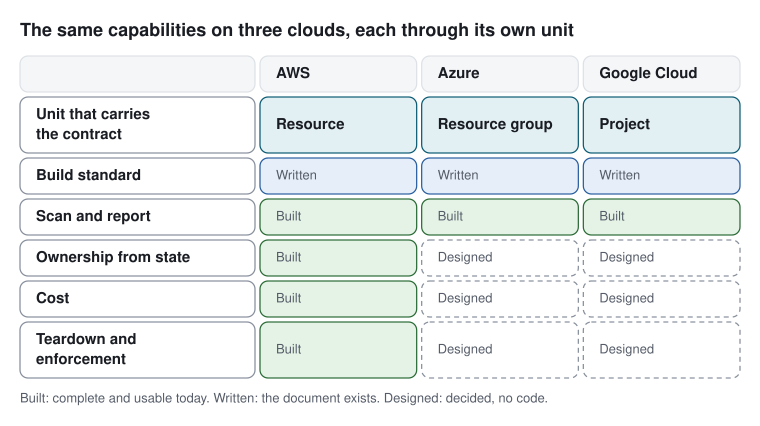

# Azure and Google Cloud

**Status: new.** AWS support is demonstrated and stable; Azure and Google Cloud support is new, has been run once against a live subscription and a live project, and may change between releases.

goat-cloud offers the same capabilities on Azure and Google Cloud as on AWS, built from each cloud's own model. Today you can build a repository to the standard for either cloud and scan a subscription or a project against the contract with one read-only command. Ownership from registered state, cost, teardown and enforcement are designed for both.



## The unit differs per cloud

Each cloud has a natural unit that is created, owned and removed as one thing. The contract attaches to it.

| | AWS | Azure | Google Cloud |
|---|---|---|---|
| Unit | resource | resource group | project |
| Carrier | tags | tags | labels |
| What is graded | every resource, on its own tags | every resource; the resource group's tags satisfy it | every deployed resource in the project |
| What is removed at expiry | the stack, by its repository | the resource group | the project |
| Build standard | [build-standard-aws.md](../build-standard-aws.md) | [build-standard-azure.md](../build-standard-azure.md) | [build-standard-gcp.md](../build-standard-gcp.md) |

The build standard for each cloud lists the rules a repository follows, each with why it exists, how it is checked and the mechanism, and comes with a reference root. Start there when you write a new root.

| Piece | Azure | Google Cloud | Status |
|---|---|---|---|
| Build standard and reference root | `docs/build-standard-azure.md`, `reference/azure` | `docs/build-standard-gcp.md`, `reference/gcp` | Written |
| Scan and report, read-only | `python -m goatcloud scan --platform azure` | `python -m goatcloud scan --platform gcp` | Built; checked against a live subscription and a live project |
| Tag or label module, registry module | `modules/azure/compliance-tags`, `modules/azure/iac-registry` | `modules/gcp/compliance-labels`, `modules/gcp/iac-registry` | Written; `terraform test` suites pass against a mocked provider |
| Ownership from state, cost, teardown, enforcement, dashboard | | | Designed |

[cloud-parity.md](../cloud-parity.md) has every capability with its mechanism on each cloud.

## Scan a subscription or a project

One command lists a scope, grades every resource against the contract and writes a report. It lists resources and changes nothing.

```sh
pip install pyyaml

# Azure: a subscription (repeatable) or a management group
pip install azure-identity azure-mgmt-resourcegraph
python -m goatcloud scan --platform azure \
  --subscription 00000000-0000-0000-0000-000000000000 \
  --out report.json --html report.html

# Google Cloud: an organization, a folder or a project
pip install google-cloud-asset
python -m goatcloud scan --platform gcp --scope projects/example-project \
  --out report.json --html report.html
```

| Cloud | Sign-in | Access needed |
|---|---|---|
| Azure | the `DefaultAzureCredential` chain; `--az-cli` uses the Azure CLI's account | Reader on the subscription or management group |
| Google Cloud | Application Default Credentials | `roles/cloudasset.viewer` on the scope; the Cloud Asset API enabled in the calling project, and `roles/serviceusage.serviceUsageConsumer` there |

| Option | Meaning |
|---|---|
| `--out` | JSON report in format 2.0; `-` writes to standard output |
| `--html` | the same report as one HTML file with no script and no external asset |
| `--mapping` | a deployment mapping: the key names and required facts of one deployment |
| `--inventory-out` | also save the inventory; `python -m goatcloud grade --inventory <file>` grades a saved inventory with no cloud access |
| `--report-inherited` | on Azure, add a LOW finding where a required fact is found only on the resource group |

### What is graded

The rules and severities are those of the AWS scanner, applied to the contract's facts.

| Rule | Severity | Category |
|---|---|---|
| Every required fact missing, or `project` or `managed_by` missing | HIGH | `tag_compliance` |
| Another required fact missing | MEDIUM | `tag_compliance` |
| `managed_by`, `lifecycle` or `repository` with a value the contract does not accept | MEDIUM | `tag_compliance` |
| Expiry in the past | HIGH | `lifecycle_compliance` |
| Expiry within 14 days | INFO | `lifecycle_compliance` |
| An expiring lifecycle with no expiry | MEDIUM | `lifecycle_compliance` |
| Expiry that is not a timestamp in the cloud's form | MEDIUM | `lifecycle_compliance` |

A resource is compliant when it has no HIGH or MEDIUM finding. The report states each category as available or not available with the reason: the unclaimed-resource, schedule and cost categories are not available on Azure and Google Cloud until their adapters are built.

| | Azure | Google Cloud |
|---|---|---|
| Key names | compared without regard to case | compared exactly |
| Inheritance | a fact on the resource group satisfies the resource; the report counts it as inherited | none |
| Expiry form | ISO 8601, `2030-12-01T00:00:00Z` | `yyyymmddthhmmz`, `20301201t0000z` |
| Repository URL | the `Repository` tag | not a label; carried by the registry entry, and not graded |

### Not every record is a resource

On Google Cloud about 60 percent of the records the inventory returns are not deployed resources: enabled APIs, backups, keys, image digests and settings. Grading them would bury the real findings, so every asset type has a class, kept as data in `adapters/gcp/resource_types.yaml`.

| Class | Meaning | Graded on |
|---|---|---|
| `resource` | deployed, and the type has a labels field | labels and ownership |
| `resource-unlabelable` | deployed, but the type has no labels field | ownership only |
| `record` | not a deployed resource | nothing; counted and listed |

The report lists each type that was left out with its count and the reason. A type with no class is graded as a resource and listed under "Unclassified types", so a new type is seen and never silently skipped.

### Keep the keys you already have

A deployment that already labels or tags under other names does not rename anything. A mapping file names, for each fact, the key that deployment uses, and may replace the set of required facts.

```yaml
contract_schema_version: "1.0"

renderings:
  gcp:
    required: [project, environment, owner, cost_center]
    facts:
      project: {key: app}
      environment: {key: stage}
      cost_center: {key: billing_code}
```

```sh
python -m goatcloud scan --platform gcp --scope projects/example-project \
  --mapping mapping.yaml --out report.json --html report.html
```

Facts, accepted values and rules still come from the contract; the mapping changes only key names and which facts are required. [reference/tag-contract.md](../reference/tag-contract.md#deployment-mapping) has the format.

## Where each cloud needs a compensating step

| Cloud | The cloud's limit | What to do |
|---|---|---|
| Azure | The provider has no default tags, and a resource does not inherit its group's tags | Tag the resource group; assign the built-in policy `Inherit a tag from the resource group` once per tag name |
| Azure | A role assignment cannot be conditioned on tags for most types | Enforcement, when built, limits its role by scope and by a short list of delete operations |
| Google Cloud | A label value cannot hold a URL or an ISO 8601 timestamp | The registry entry carries the repository URL; the expiry is written as `yyyymmddthhmmz` |
| Google Cloud | IAM cannot be conditioned on labels for most types | Enforcement, when built, limits its role to named projects and a short list of delete permissions |
| Both | No scheduled scanner runs in the cloud yet | Run `python -m goatcloud scan` from a scheduled CI job with workload identity federation, and store the report |

## Registry entry

The registry entry sits beside the state, because a scanner already needs read access to that store. Registration adds no service, no API to enable and no second permission.

| | Azure | Google Cloud |
|---|---|---|
| Entry | blob `iac-registry/<slug>.json` in the state container | object `iac-registry/<slug>.json` in the stack's state bucket |
| Written by | `modules/azure/iac-registry` | `modules/gcp/iac-registry` |
| How a scanner finds it | Resource Graph query for storage accounts tagged `role=iac-registry` | Cloud Asset Inventory search for buckets labelled `role=iac-registry` |
| Marker on the state store | tag `role=iac-registry` on the storage account | label `role=iac-registry` on the bucket; the module stops the plan when it is missing |

The modules write the entries today. Reading them to decide ownership is designed.

## Designed next

| Step | Azure | Google Cloud |
|---|---|---|
| Ownership from registered state | registry blobs and state in Azure Storage | registry objects and state in Cloud Storage |
| Scheduled scan in the cloud | a Container Apps job | a Cloud Run job |
| Expiry teardown | the expiry-teardown dispatcher ([expiry-teardown.md](expiry-teardown.md)); the repository's workflow removes the resource group | the same dispatcher; the workflow removes the project |
| Cost | Cost Management query API | Cloud Billing export in BigQuery, when the adopter has enabled it |
| Single-resource deletion | a role limited by scope and operation list | a role limited by project and permission list |
