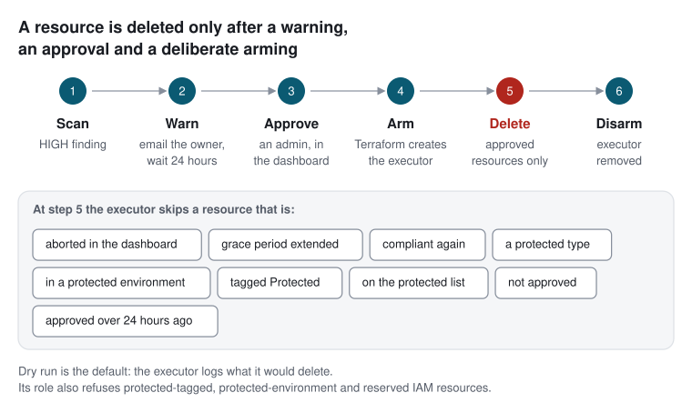
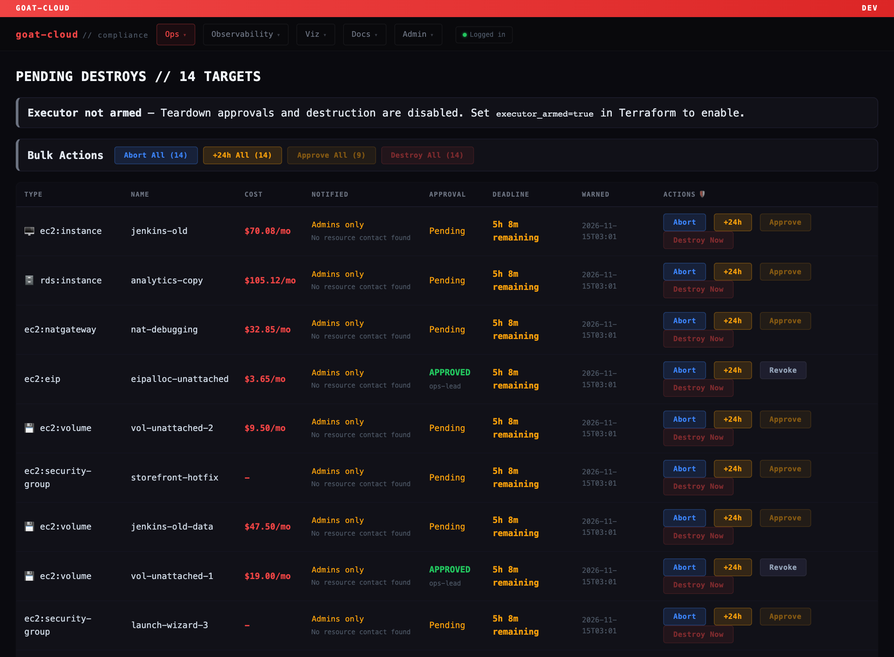

# Arm enforcement safely

Enforcement deletes single resources that have a HIGH finding, after a warning and an approval. It is deployed in three stages, and each stage is useful by itself: warnings only, a dry run of deletion, then deletion. Stay at a stage until what it reports is what you expect.



The module is `modules/aws/hunterkiller`. It contains two Lambda functions. The **notifier** is always deployed, warns owners and records state, and has no delete permission. The **executor** deletes; it and its role exist only while `executor_armed = true`.

## Stage 1: warnings only

Deploy the notifier and connect it to the scanner. Nothing can be deleted at this stage: no function in the account has permission to.

```hcl
module "enforcement" {
  source = "git::https://github.com/USAREUR-AF/goat-cloud.git//modules/aws/hunterkiller?ref=v0.1.0"

  project     = "acme"
  environment = "dev"

  compliance_reports_bucket        = module.scanner.reports_bucket
  compliance_scanner_function_name = "acme-dev-compliance-scanner"

  ses_sender_email = "cloud-reports@acme.example"
  ses_admin_emails = ["cloud-admins@acme.example"]

  # defaults, shown for clarity
  executor_armed = false
  dry_run        = true
}

module "scanner" {
  # ... inputs from the quick start ...
  hunterkiller_function_name = "acme-dev-hunterkiller"
}
```

Both function names are fixed by `project` and `environment` (`<project>-<environment>-compliance-scanner`, `<project>-<environment>-hunterkiller`), so each module takes the other's name as a string and neither depends on the other's outputs. `ses_sender_email` must be a verified SES identity.

After each scan the scanner invokes the notifier. For every HIGH finding on an active resource the notifier:

1. skips the resource if it is protected (see "Protect what must never be deleted" below);
2. finds a contact: the tags in `contact_tag_keys` (default `Contact`), in order; else, when `ManagedBy` holds an IAM user name in place of a tool name, that user's `Email` tag; else `ses_admin_emails`;
3. sends one warning email per contact, listing the resources, their cost, the issue and the deadline;
4. writes a record per resource to the state table `<project>-<environment>-hunterkiller-state` with `status = warned`, `approval_status = pending` and a `grace_deadline` 24 hours ahead (`grace_period_hours`).

What to check before moving on: the warnings go to the right people, and the list of warned resources contains nothing that must be kept. The dashboard's pending view (`/pending`) shows the same list.



### Protect what must never be deleted

Four independent settings exempt a resource. A resource that matches any one of them is never deleted by the executor, whatever its approval state.

| Setting | Default | Exempts |
|---|---|---|
| `protected_resource_types` | `route53:hostedzone`, `payments:payment-instrument`, `s3:bucket` | every resource of these types |
| `protected_environments` | `prod`, `production` | resources whose `Environment` tag has one of these values |
| `protected_tag_key` | `Protected` | resources tagged `Protected=true` |
| `protected_resources_ssm_name` | none | resources whose ARN matches a pattern in the named SSM parameter |

The protected list is JSON in one SSM parameter. A pattern matches an ARN that equals it or starts with it; `*` stands for the account id.

```hcl
resource "aws_ssm_parameter" "protected_resources" {
  name = "/acme/dev/protected-resources"
  type = "String"
  tier = "Advanced"

  value = jsonencode({
    resources = [
      { arn_pattern = "arn:aws:s3:::acme-tf-state", category = "terraform_state", action = "never_destroy", reason = "Terraform state" },
      { arn_pattern = "arn:aws:dynamodb:us-east-1:*:table/acme-tf-lock", category = "terraform_state", action = "never_destroy", reason = "State lock" },
      { arn_pattern = "arn:aws:rds:us-east-1:*:db:ledger", category = "data", action = "never_destroy", reason = "System of record" },
    ]
  })
}
```

Pass the parameter name as `protected_resources_ssm_name` to the scanner, the enforcement module and the dashboard. The functions read it on every run, so a change takes effect without a deployment.

## Stage 2: dry run of deletion

Arm the executor with dry run still on. The executor now exists and runs every check, and logs what it would delete without calling a delete API.

```hcl
  executor_armed = true
  dry_run        = true
```

`terraform apply` creates the executor Lambda `<project>-<environment>-hunterkiller-executor` and its role. From the next scan on, each warning batch schedules one executor run at the end of its grace period.

In the dashboard, with `hunterkiller_executor_armed = true` passed to the dashboard module, administrators approve resources on the pending view. At its run the executor takes each warned resource through these checks, in this order, and stops at the first that applies:

| Check | Result |
|---|---|
| An administrator aborted it | skipped |
| Its grace deadline was extended and has not passed | skipped until the next run |
| It no longer has a finding in the latest report | marked `resolved` |
| It is protected (type, environment, tag or list) | marked `protected` |
| Its approval status is not `approved` | skipped |
| It was approved more than 24 hours ago | approval marked `expired`; skipped |
| None of the above | deleted, or in dry run logged as `dry_run` |

After the run the executor mails a report to `ses_admin_emails` with a "DRY RUN" banner: what would have been deleted, what was resolved, what was protected, and the monthly cost of each group.

What to check before moving on: over several runs, the "would delete" list holds only resources you would delete by hand.

## Stage 3: deletion

```hcl
  executor_armed = true
  dry_run        = false
```

From this apply on, an approved, unprotected resource whose grace period has passed is deleted at the next executor run. An administrator can also delete one approved resource at once with "Destroy Now" on the pending view.

The executor acts on these types: EC2 instances, EBS volumes, security groups and rules, Elastic IPs, NAT gateways, VPC flow logs, RDS instances and cluster parameter groups, ECS services, Lambda functions, S3 buckets, ElastiCache clusters, load balancers, SSM parameters, ECR repositories, EventBridge rules, log groups, Secrets Manager secrets, KMS keys, IAM roles, users and policies, and Route 53 zones. S3 buckets and Route 53 zones are in the default protected types, so they are acted on only if you remove them from `protected_resource_types`.

Two limits are enforced by AWS and not by the executor's code. The executor's role allows delete actions on EC2, RDS, ECS, Lambda, ElastiCache and load balancers only when the resource is not tagged `Protected=true` and its `Environment` tag is not `prod` or `production`. The role is denied on S3 buckets named `<project>-*-tf-state` and `<project>-*-compliance-reports`. IAM, Route 53, SSM parameters, log groups and other S3 buckets have no such condition: they are protected by the executor's checks and the approval.

### Disarm

When a cleanup is finished, set `executor_armed = false` and apply. The executor function and its role are destroyed, and the account again holds no identity that can delete on the tooling's behalf. Warnings continue.

A team that cleans up a few times a year arms for the cleanup and disarms after it. A team that wants temporary resources removed without attention leaves the executor armed in a non-production account and sets `auto_approve_expired = true`.

The budget module (`governance`) deletes nothing. Its input `enable_auto_termination` is kept only so an existing call still parses; `true` fails the plan. See [concepts](../concepts.md#enforcement-gates).

## Automatic approval of expired resources

`auto_approve_expired = true` makes the notifier approve, as `auto:expired`, any warned resource whose `ExpiresAt` tag is in the past. Resources without `ExpiresAt` still need an administrator. Every other check still applies. Use it in environments where an expiry tag is the owner's consent; leave it `false` where a person should look first.

## Administrator actions

| Action | Effect |
|---|---|
| Abort | The resource is skipped by every later run of this batch |
| +24h | Moves the grace deadline 24 hours later |
| Approve | Sets `approval_status = approved`, with the administrator's address and the time |
| Revoke | Returns an approved resource to `pending` |
| Destroy Now | Runs the executor for one approved resource; needs the executor armed |

Each action is recorded on the resource's row in the state table. Rows expire after `state_ttl_days` (default 30). The executor's API calls appear in CloudTrail under its role.

## Inputs used in this guide

| Input | Default | Meaning |
|---|---|---|
| `executor_armed` | `false` | create the executor Lambda and its role |
| `dry_run` | `true` | log deletions without performing them |
| `grace_period_hours` | `24` | hours between warning and the executor's run |
| `auto_approve_expired` | `false` | approve resources past their `ExpiresAt` without an administrator |
| `contact_tag_keys` | `Contact` | tags read, in order, for the owner's address; add keys such as `OwnerEmail` to read others |

All inputs: [reference/module-inputs.md](../reference/module-inputs.md).
