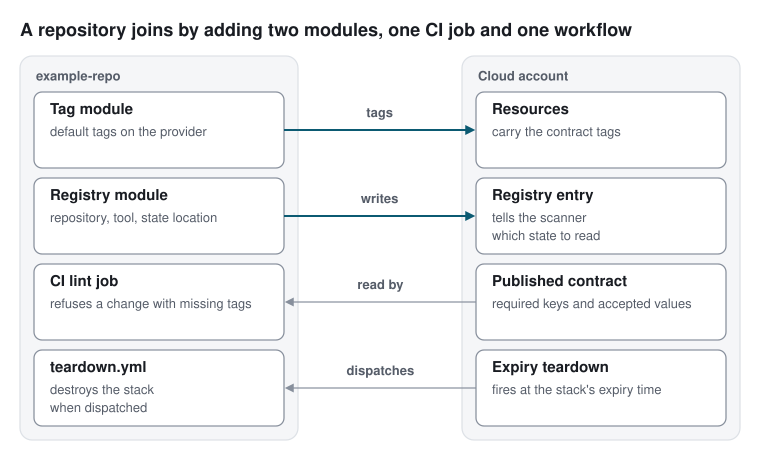
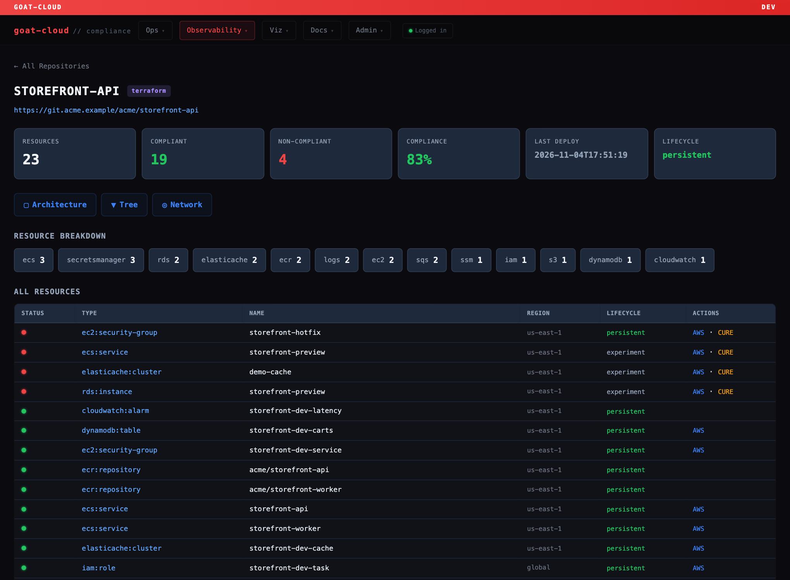

# Onboard a repository

A repository is onboarded when its resources carry the contract tags and the scanner can read its state. That takes two additions to the repository (tags and a registry entry) and one CI job that keeps the tags from being removed. Nothing is changed in the platform root, the Terraform root that deploys the scanner ([concepts.md](../concepts.md)).



This guide assumes the scanner is deployed ([quickstart-aws.md](../quickstart-aws.md)) in project `acme`, environment `dev`, and that the repository is `https://github.com/acme/example-repo`.

## 1. Tag everything the repository deploys

Every resource needs `Project`, `Environment`, `ManagedBy`, `Lifecycle` and `Repository`. Set them once, at the level your tool applies to all resources.

### Terraform

```hcl
module "compliance" {
  source = "git::https://github.com/USAREUR-AF/goat-cloud.git//modules/aws/compliance-tags?ref=v0.1.0"

  project         = "acme"
  environment     = "dev"
  repository_url  = "https://github.com/acme/example-repo"
  lifecycle_value = "persistent"
}

provider "aws" {
  region = "us-east-1"

  default_tags {
    tags = module.compliance.default_tags
  }
}
```

The module reads the published contract from the SSM parameter `/acme/dev/compliance-contract` (see step 4). Set `use_ssm_contract = false` to use the contract built into the module.

For a stack that should be removed later, set `lifecycle_value = "temporary"` and `expires_at = "2030-06-30T00:00:00Z"`. Terraform reports a failed check on every plan when a temporary stack has no expiry, and the scanner reports the resources.

The module may have any name. The CI lint in step 3 recognizes it by its source (a path ending in `compliance-tags`) and treats a reference to its `default_tags` output as providing every required tag.

### Other tools

| Tool | Where the tags go | `ManagedBy` |
|---|---|---|
| OpenTofu | as for Terraform: the same modules and `default_tags` | `opentofu` |
| Serverless Framework | `provider.stackTags` and `provider.tags` in `serverless.yml`; set both, because some resources read only one | `serverless` |
| AWS CDK | `cdk.Tags.of(app).add(key, value)` for each tag, in the app entry point | `cdk` |
| AWS SAM | `Globals.Function.Tags` for functions, and `Properties.Tags` on every other resource | `sam` |
| AWS Copilot | `tags:` in each service manifest | `copilot` |
| CloudFormation | `--tags` on `aws cloudformation deploy`, or `Tags` on each resource | `cloudformation` |
| Pulumi | one tag map passed to every resource, or the provider's `defaultTags` | `pulumi` |
| Console or CLI, for a resource that must stay hand-made | tag it directly | `manual` |

A resource tagged `ManagedBy=manual` passes the tag check. It still has a drift finding, because no state claims it; an administrator marks it as accepted in the dashboard's overrides view.

## 2. Register where the state lives

The registry entry is what lets the scanner treat the repository's resources as owned.

### Terraform

```hcl
module "registry" {
  source = "git::https://github.com/USAREUR-AF/goat-cloud.git//modules/aws/iac-registry?ref=v0.1.0"

  project     = "acme"
  environment = "dev"
  repo_slug   = "example-repo"
  repo_url    = "https://github.com/acme/example-repo"
  iac_type    = "terraform"

  state_location = {
    type   = "s3_tfstate"
    bucket = "acme-tf-state"
    key    = "example-repo/dev/terraform.tfstate"
  }

  tags = module.compliance.default_tags
}
```

The scanner's role must be able to read that state object. In the platform root, the scanner input `iac_registry_state_buckets` lists the buckets that hold registered Terraform and Pulumi state. A repository that keeps its state in a bucket already on that list needs no platform change.

### Other tools

Write the entry from CI after each deployment:

```sh
aws ssm put-parameter \
  --name "/acme/dev/iac-registry/example-repo" \
  --type String --overwrite \
  --value "$(jq -n \
    --arg url 'https://github.com/acme/example-repo' \
    --arg ts "$(date -u +%Y-%m-%dT%H:%M:%SZ)" \
    '{repo_url: $url, iac_type: "serverless",
      state_location: {type: "cfn_stack", stack_names: ["example-repo-dev"]},
      last_deploy: $ts, deployer: "github-actions",
      environment: "dev", version: "1.0"}')"
```

| Tool | `iac_type` | `state_location` |
|---|---|---|
| Serverless Framework | `serverless` | `{type: "cfn_stack", stack_names: ["<service>-<stage>"]}` |
| CDK | `cdk` | `{type: "cfn_stack", stack_names: [every stack the app creates]}` |
| SAM | `sam` | `{type: "cfn_stack", stack_names: ["<stack>"]}` |
| Copilot | `copilot` | `{type: "cfn_stack", stack_names: [the environment stack and each service stack]}` |
| CloudFormation | `cloudformation` | `{type: "cfn_stack", stack_names: ["<stack>"]}` |
| Pulumi, S3 backend | `pulumi` | `{type: "pulumi_s3", bucket: "<bucket>", project: "<project>"}` |

For Pulumi the entry's `environment` selects the stack: `dev` reads `.pulumi/stacks/<project>/dev.json`. Pulumi Cloud state cannot be read; resources deployed that way pass the tag check and keep a drift finding.

The deployment role needs `ssm:PutParameter` on `arn:aws:ssm:<region>:<account>:parameter/acme/dev/iac-registry/*`.

## 3. Check tags in CI

`scripts/compliance-lint` reads a repository's IaC files and fails when the required tags are not set. Run it before the deployment job.

```yaml
jobs:
  compliance:
    runs-on: ubuntu-latest
    steps:
      - uses: actions/checkout@v4
      - uses: actions/checkout@v4
        with:
          repository: USAREUR-AF/goat-cloud
          ref: v0.1.0
          path: .governance
      - uses: actions/setup-python@v5
        with:
          python-version: "3.12"
      - run: pip install pyyaml
      - run: python .governance/scripts/compliance-lint --iac-type terraform --path .
```

| Option | Meaning |
|---|---|
| `--iac-type` | `terraform`, `serverless`, `cloudformation`, `pulumi` or `cdk` |
| `--path` | directory or file to check; default `.` |
| `--contract-ssm <name>` | read the contract from an SSM parameter (needs `boto3` and AWS credentials in the job) |
| `--contract-s3 s3://bucket/key` | read the contract from an S3 object |

With neither contract option, and without `COMPLIANCE_CONTRACT_SSM` or `COMPLIANCE_CONTRACT_S3` in the environment, the lint uses the contract built into the script.

For Terraform the lint requires a provider `default_tags` block that either references the `default_tags` output of the `compliance-tags` module or assigns every required key. For CloudFormation and Serverless templates it checks the tag keys on each tagged resource.

The reusable workflow `.github/workflows/compliance-check.yml` wraps the same script for `workflow_call`. It fetches the script and the contract from an S3 bucket; a platform that uses it publishes both objects to a bucket of its own and sets the bucket name in the workflow.

## 4. Publish the contract (once, in the platform root)

Publishing the contract lets every repository and every CI job read the same required keys and accepted values. It is one SSM parameter.

```hcl
resource "aws_ssm_parameter" "compliance_contract" {
  name  = "/acme/dev/compliance-contract"
  type  = "String"
  value = file("${path.module}/compliance-contract.aws.json")
}
```

Copy `contract/dist/compliance-contract.aws.json` from this repository into the platform root; it is generated from `contract/contract.yaml`, and [reference/tag-contract.md](../reference/tag-contract.md#published-contract) shows its fields. A deployment with a mapping publishes the file `scripts/contract-gen --mapping` writes instead.

After it exists, repositories drop `use_ssm_contract = false`, and CI jobs pass `--contract-ssm /acme/dev/compliance-contract`.

## 5. Confirm

After the repository deploys and the next scan runs, three things are true:

| Check | Where |
|---|---|
| The repository is listed with its tool, resource count and last deployment | dashboard `/repos`, or `iac_registry.entries` in the JSON report |
| Its resources have no `drift_detection` findings | dashboard `/repos/example-repo`, or the report |
| Its resources have no `tag_compliance` findings | the same views |



To check without waiting for the nightly scan, start one: `aws lambda invoke --function-name acme-dev-compliance-scanner --invocation-type Event /dev/null`.

## Remove a repository

Delete its registry entry when its stack is destroyed, so the scanner stops reading a state that no longer exists. With the Terraform module, `terraform destroy` removes the entry. Otherwise run `aws ssm delete-parameter --name /acme/dev/iac-registry/example-repo` as the last step of the teardown.
