# Read a report and the dashboard

Each scan produces one report in three formats, and the dashboard shows the same data with history, cost and actions. This guide explains what each part tells you and what to do about it.

## The report files

The scanner writes to the report bucket under `reports/<YYYY-MM-DD>/`:

| File | For | Contents |
|---|---|---|
| `compliance-report.html` | a person | summary, changes since the previous scan, charts, every finding with a console link |
| `compliance-report.md` | a person, in a terminal or a pull request | the same findings as text, with a suggested removal command for each unowned resource |
| `compliance-report.json` | a program | everything: all resources, all findings, costs. [reference/report-schema.md](../reference/report-schema.md) |

When `ses_sender_email` and `ses_recipient_emails` are set on the scanner, the HTML summary is mailed after each scan with the full report attached.

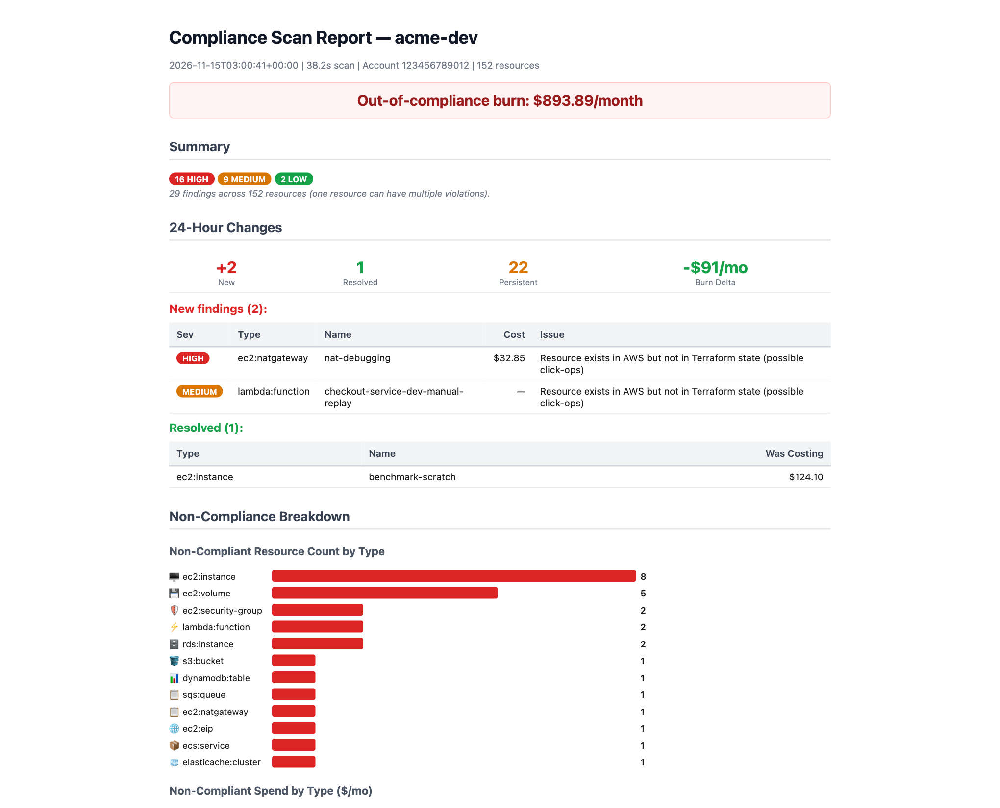

Read the HTML report from the top:

1. **Out-of-compliance burn.** The estimated monthly cost of every active resource that has a finding. This is the amount that fixing or removing those resources would account for.
2. **Summary.** Findings by severity. One resource can have several findings.
3. **24-hour changes.** New findings, resolved findings, findings that persist, and the change in burn. A new HIGH finding is something that appeared since yesterday.
4. **Breakdown.** Non-compliant resources by type, by count and by spend.
5. **Findings.** Grouped by resource, highest severity first, each with its issue and a recommendation.

## What to do with a finding

| Finding | Usual cause | Action |
|---|---|---|
| Tag finding on a resource a repository deploys | the tool does not apply default tags to that resource type, or the tags are set on only part of the stack | add the tags in the repository; [onboard-a-repository.md](onboard-a-repository.md) |
| Drift finding on a tagged resource | the repository is not registered, the scanner cannot read its state bucket, or the resource was made by hand with copied tags | register the repository; add the bucket to `iac_registry_state_buckets`; or import the resource into the repository's state |
| Tag and drift findings together | made by hand in the console or with the CLI | find the creator in the finding's `created_by`; import it into a repository or delete it |
| Lifecycle finding, expired | a temporary resource is past its `ExpiresAt` | delete it, or set a later `ExpiresAt` if it is still needed |
| Schedule finding | a non-persistent instance, database, service or cache runs all day | add a `Schedule` tag and stop it out of hours, or set `Lifecycle=persistent` |
| Drift finding on something the cloud or another system creates | a pattern the scanner does not know | add it to `exclusion_patterns` or `exclusion_arns`, or mark it in the dashboard's overrides view |

## The dashboard

The dashboard (module `compliance-dashboard`) is a Lambda behind an HTTPS load balancer listener, a function URL, or both. It reads the report bucket, the report index table and the enforcement state table. Viewing is read-only; actions that change enforcement state are limited to the addresses in `admin_emails`.

To try every view on synthetic data, run `python3 demo/serve.py`.

### Overview (`/`)

Counts of resources and of findings by severity, pending deletions, when each job last ran, and links to the other views. Administrators also start a scan and download the latest report here.

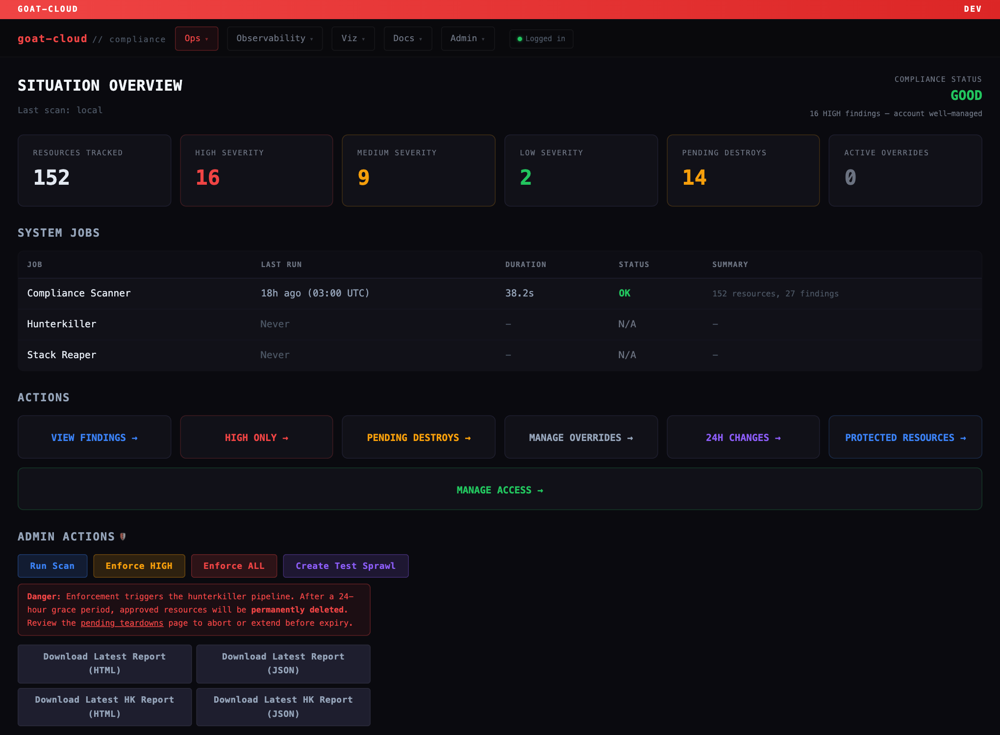

### Findings (`/findings`)

Every finding in one table: severity, type, name, whether a state claims it, its enforcement status, region, state, contact, issue, cost and age. Filters select a severity, and compliant or non-compliant resources. Each row opens the resource's detail.

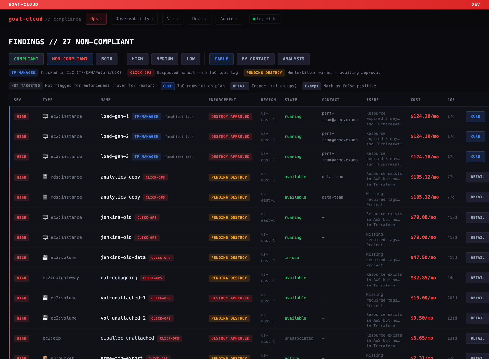

The enforcement column shows where a resource is in the deletion process: not targeted, warned and awaiting approval, or approved.

### Resource detail (`/cure?arn=...`)

One resource: its identifier, its current tags, every finding against it, and a remediation plan with the commands to import it, tag it or delete it.

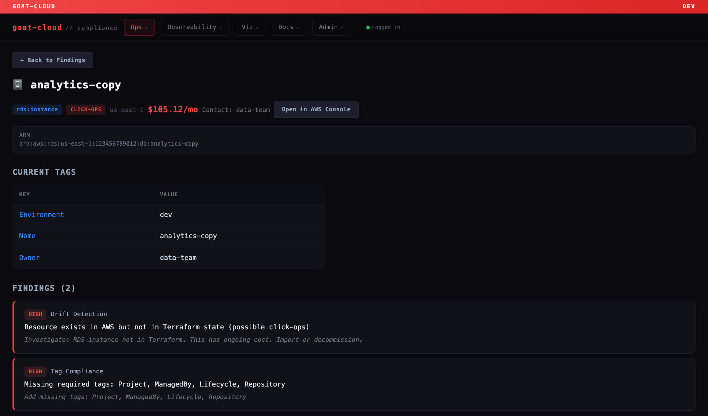

### Cost (`/burn`)

Billed spend from Cost Explorer beside the per-resource estimates, with the estimates split into compliant and non-compliant and into attributed (has a `Service` tag) and unattributed. Below that, spend by service, and billed services for which the scanner found no resource.

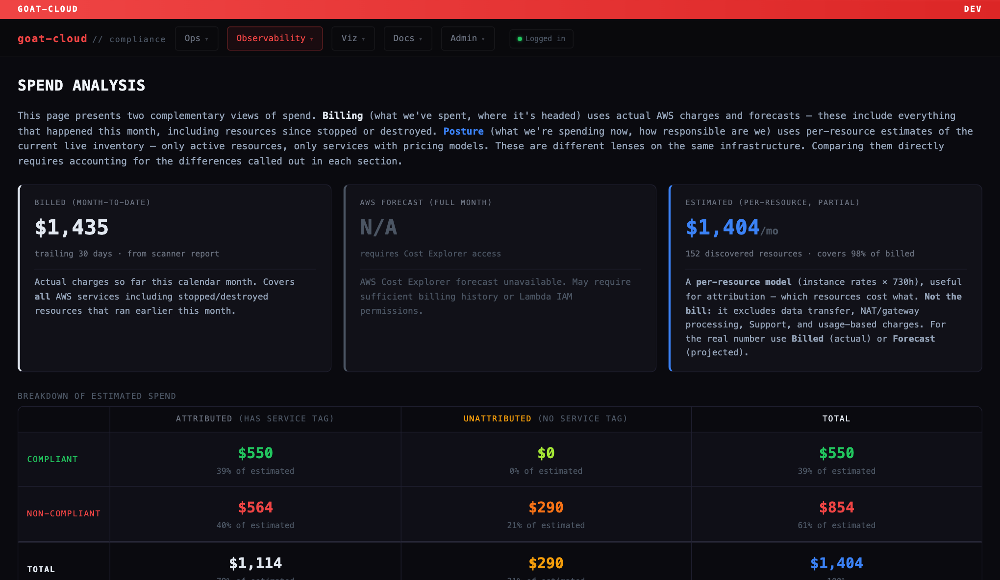

The forecast tile needs Cost Explorer forecast access and at least a few weeks of billing history.

### Changes (`/changes`)

What is different from the scan 24 hours earlier: new findings and their cost, resolved findings and what they saved, and the number that persist.

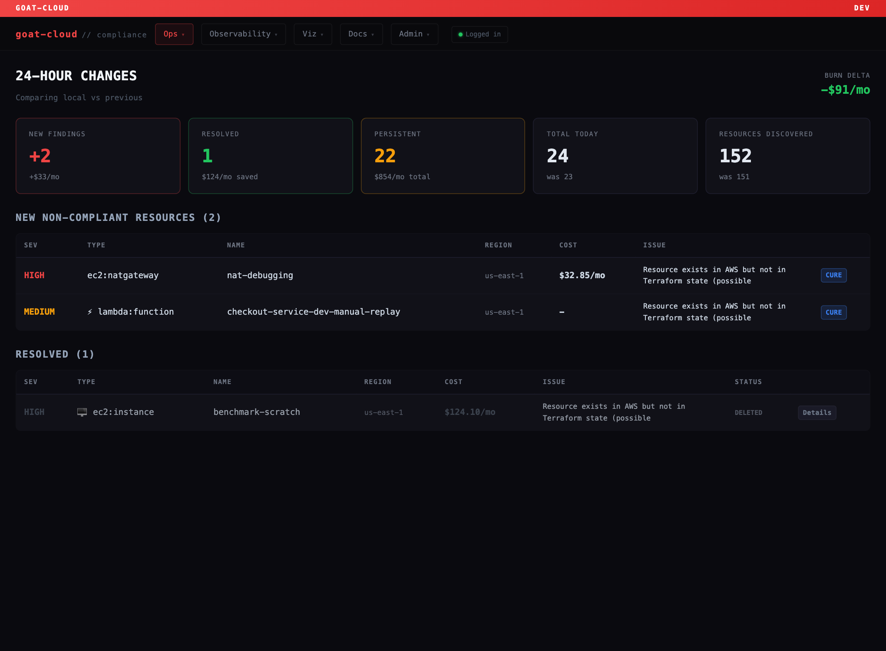

### Repositories (`/repos` and `/repos/<slug>`)

Every registered repository with its tool, resource count, findings, compliance rate, last deployment and lifecycle. A temporary repository shows when its teardown is due. The detail page lists the repository's resources and links to its tree and network views.

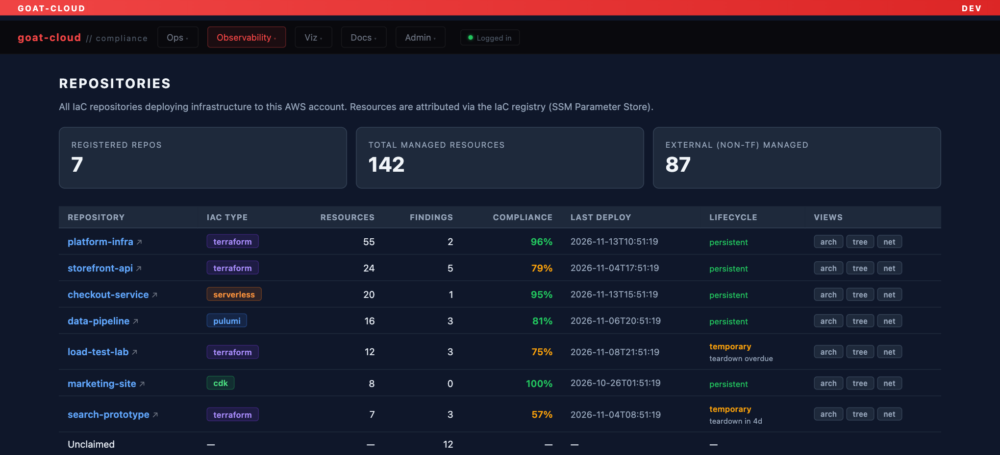

### State tree (`/tree`)

The platform root's Terraform state as modules and resources, each marked compliant or not. Use it to find which module a resource belongs to.

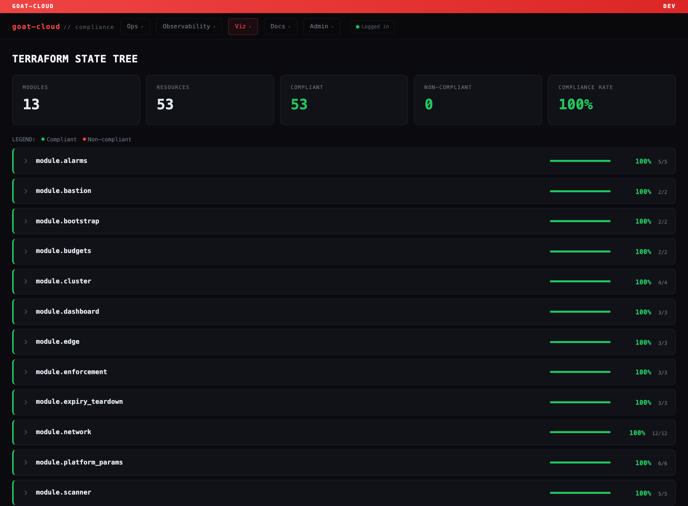

### Network (`/network`)

A graph of the account: Terraform modules, and groups of resources no module holds, sized by resource count and colored by status. Click a group to expand it; press `N` to show only non-compliant resources.

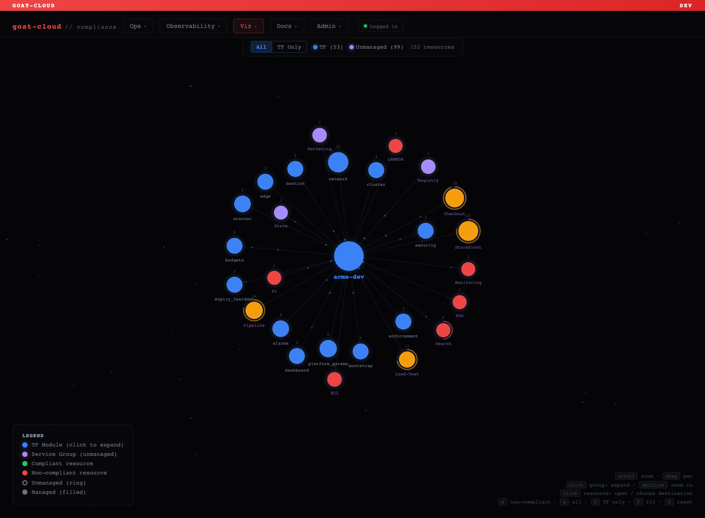

### Protected resources (`/protected`)

Resources that single-resource enforcement never deletes: state buckets, lock tables, every S3 bucket, and the entries of the protected list. Each still shows its compliance status.

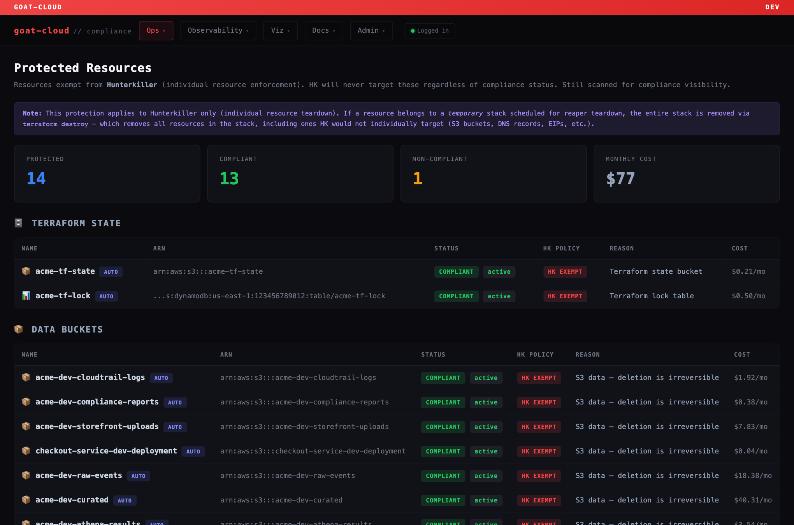

### Pending approvals (`/pending`)

Every resource the notifier has warned about, with who was notified, the approval state and the time left in the grace period. Administrators abort, extend by 24 hours, approve or revoke here. [arm-enforcement.md](arm-enforcement.md) covers the process.

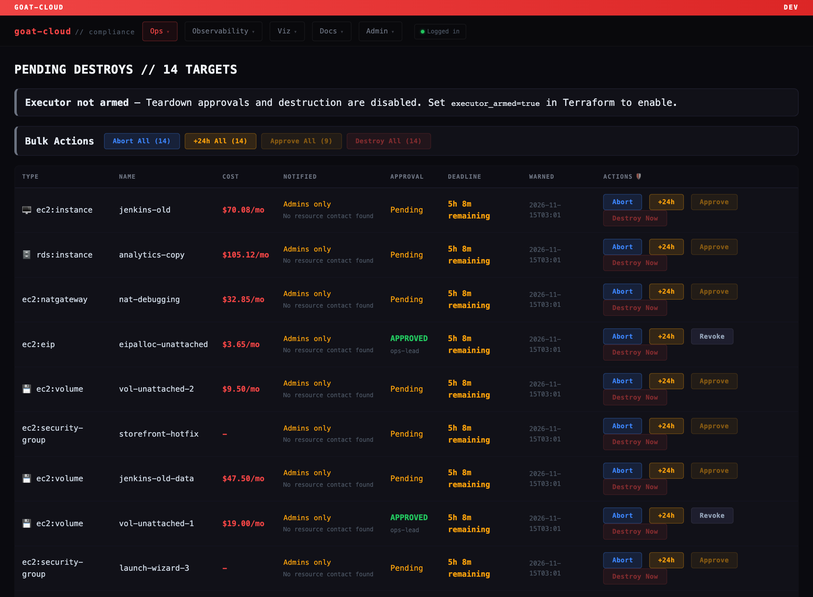

### Other views

| Path | Shows |
|---|---|
| `/overrides` | resources an administrator marked as a false positive or exempt; the scanner leaves them out of findings |
| `/compliant`, `/all` | resources without findings; every resource |
| `/architecture` | diagrams drawn from the platform root's Terraform state and module metadata |
| `/security` | internet exposure, authentication and container image status, from Terraform state |
| `/access` | who may view and who may act, when `enable_viewer_gate` is on |
| `/self` | the dashboard's own configuration and data sources |
