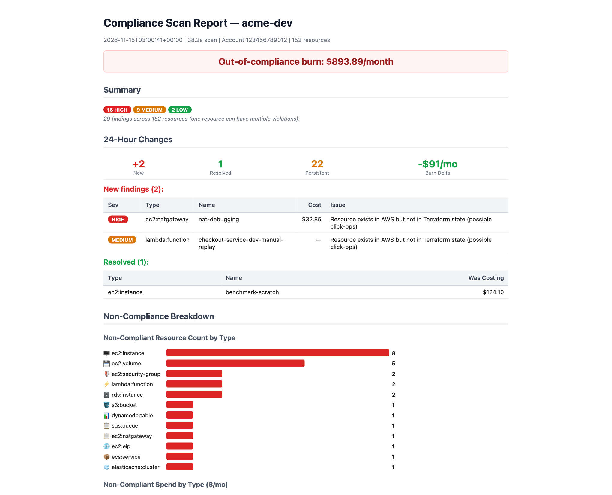

# Quick start on AWS

This page takes an AWS account with nothing in it to a first scan report. You create one Terraform root that tags its own resources, registers itself and deploys the scanner (the rest of the documentation calls it the **platform root**: the root that deploys goat-cloud's own modules); you run one scan; you read the report. It deletes nothing: the scanner's role is read-only apart from writing its own reports.

Allow about 20 minutes. The resources cost less than 1 USD a month at this size (one Lambda function, one S3 bucket, one DynamoDB table, one log group).

## Before you start

| You need | Why |
|---|---|
| An AWS account and credentials that can create IAM roles, Lambda functions, S3 buckets, DynamoDB tables and SSM parameters | Terraform creates all of these |
| Terraform 1.5 or newer, and the AWS CLI version 2 | `terraform apply` and the commands below |
| `zip` and a POSIX shell on the machine that runs Terraform | the scanner module packages its Lambda source with a local `zip` command |
| Cost Explorer enabled in the account (Billing console, Cost Explorer, one click) | the scanner reads spend per service and uses spend per region to choose which regions to scan. Without it the scan covers `us-east-1` and the scanner's own region, and service costs are empty |

The examples use project `acme`, environment `dev`, region `us-east-1`, account `123456789012` and the repository `https://github.com/acme/platform`. Replace them with your own. S3 bucket names are global, so choose your own state bucket name in place of `acme-tf-state`.

## 1. Create a bucket for Terraform state

The scanner decides ownership by reading Terraform state, so the state has to live in S3 from the first apply.

```sh
aws s3api create-bucket --bucket acme-tf-state --region us-east-1
aws s3api put-bucket-versioning --bucket acme-tf-state \
  --versioning-configuration Status=Enabled
aws s3api put-public-access-block --bucket acme-tf-state \
  --public-access-block-configuration \
  BlockPublicAcls=true,IgnorePublicAcls=true,BlockPublicPolicy=true,RestrictPublicBuckets=true
```

In a region other than `us-east-1`, add `--create-bucket-configuration LocationConstraint=<region>` to the first command.

## 2. Write the root

Create an empty directory, and in it the file `main.tf`:

```hcl
terraform {
  required_providers {
    aws = {
      source  = "hashicorp/aws"
      version = ">= 5.0"
    }
  }

  backend "s3" {
    bucket = "acme-tf-state"
    key    = "platform/dev/terraform.tfstate"
    region = "us-east-1"
  }
}

locals {
  project     = "acme"
  environment = "dev"
  repo_url    = "https://github.com/acme/platform"
}

module "compliance" {
  source = "git::https://github.com/USAREUR-AF/goat-cloud.git//modules/aws/compliance-tags?ref=v0.1.0"

  project          = local.project
  environment      = local.environment
  repository_url   = local.repo_url
  use_ssm_contract = false
}

provider "aws" {
  region = "us-east-1"

  default_tags {
    tags = module.compliance.default_tags
  }
}

module "registry" {
  source = "git::https://github.com/USAREUR-AF/goat-cloud.git//modules/aws/iac-registry?ref=v0.1.0"

  project     = local.project
  environment = local.environment
  repo_slug   = "platform"
  repo_url    = local.repo_url
  iac_type    = "terraform"

  state_location = {
    type   = "s3_tfstate"
    bucket = "acme-tf-state"
    key    = "platform/dev/terraform.tfstate"
  }
}

module "scanner" {
  source = "git::https://github.com/USAREUR-AF/goat-cloud.git//modules/aws/compliance-scanner?ref=v0.1.0"

  project     = local.project
  environment = local.environment

  tf_state_bucket = "acme-tf-state"
  tf_state_key    = "platform/dev/terraform.tfstate"

  iac_registry_state_buckets = ["acme-tf-state"]
  exclusion_arns             = ["arn:aws:s3:::acme-tf-state"]
  cli_prefix                 = "aws"
  repository_url             = local.repo_url
}

output "reports_bucket" {
  value = module.scanner.reports_bucket
}

output "scanner_function" {
  value = module.scanner.lambda_function_name
}
```

What each block does:

| Block | Effect |
|---|---|
| `module "compliance"` | Builds the five required tags (`Project`, `Environment`, `ManagedBy=terraform`, `Lifecycle=persistent`, `Repository`). `use_ssm_contract = false` uses the contract built into the module; a published contract is added in [guides/onboard-a-repository.md](guides/onboard-a-repository.md) |
| `provider "aws" { default_tags }` | Puts those tags on every resource this root creates |
| `module "registry"` | Writes the SSM parameter `/acme/dev/iac-registry/platform`, which tells the scanner where this root's state is |
| `module "scanner"` | Creates the scanner Lambda `acme-dev-compliance-scanner`, its read-only role, the report bucket `acme-dev-compliance-reports`, a report index table, and a nightly schedule at 03:00 UTC |
| `exclusion_arns` | Keeps the state bucket, which was made by hand in step 1, out of the drift findings |

## 3. Apply

```sh
terraform init
terraform apply
```

The plan creates about 16 resources. After the apply, `terraform output` prints the report bucket and the function name.

## 4. Run a scan

The schedule runs the scanner every night. To get a report now, start it once:

```sh
aws lambda invoke --function-name acme-dev-compliance-scanner \
  --invocation-type Event --region us-east-1 /dev/null
```

A scan of a small account takes under a minute. Then list today's reports:

```sh
aws s3 ls s3://acme-dev-compliance-reports/reports/$(date -u +%Y-%m-%d)/
```

Three files appear: `compliance-report.json`, `compliance-report.md` and `compliance-report.html`. If the listing is empty after two minutes, read the function's log:

```sh
aws logs tail /aws/lambda/acme-dev-compliance-scanner --since 10m --region us-east-1
```

## 5. Read the report

```sh
aws s3 cp s3://acme-dev-compliance-reports/reports/$(date -u +%Y-%m-%d)/compliance-report.html .
open compliance-report.html        # macOS; on Linux use xdg-open
```



In a new account the report lists the resources of this root as owned, with no findings against them. What remains is what the account held before: resources AWS created with the account and anything made by hand. Each is a drift finding, a tag finding, or both. [guides/read-a-report.md](guides/read-a-report.md) explains every section.

To browse the same report in the dashboard on your machine, without deploying the dashboard:

```sh
mkdir my-report
aws s3 cp s3://acme-dev-compliance-reports/reports/$(date -u +%Y-%m-%d)/compliance-report.json my-report/
aws s3 cp s3://acme-tf-state/platform/dev/terraform.tfstate my-report/
git clone https://github.com/USAREUR-AF/goat-cloud
pip install boto3
DEMO_DATA_DIR=$PWD/my-report PROJECT=acme ENVIRONMENT=dev python3 goat-cloud/demo/serve.py
```

A Terraform state file can hold secret values. Keep `my-report/` out of version control and delete it when you are done.

## 6. See a finding appear

Create one resource by hand, scan again, and it shows up as untagged and unowned.

```sh
aws sqs create-queue --queue-name made-by-hand --region us-east-1
aws lambda invoke --function-name acme-dev-compliance-scanner \
  --invocation-type Event --region us-east-1 /dev/null
```

The next report has a HIGH `tag_compliance` finding for `made-by-hand` (no required tags) and a `drift_detection` finding (no registered state claims it). Remove the queue with `aws sqs delete-queue` and the following scan lists both findings as resolved.

## Next steps

| To do this | Read |
|---|---|
| Receive the report by email each morning | Set `ses_sender_email` and `ses_recipient_emails` on the scanner module; the sender must be a verified SES identity. [reference/module-inputs.md](reference/module-inputs.md) |
| Bring your other repositories in | [guides/onboard-a-repository.md](guides/onboard-a-repository.md) |
| Deploy the dashboard | `modules/aws/compliance-dashboard`; it attaches to an HTTPS Application Load Balancer listener that you provide, or, with `enable_alb = false` and `enable_function_url = true`, is reached through a Lambda function URL. [reference/module-inputs.md](reference/module-inputs.md) |
| Add budget alerts | `modules/aws/governance` with `owner_email` and `monthly_budget_limit` |
| Warn owners and delete with approval | [guides/arm-enforcement.md](guides/arm-enforcement.md) |

## Remove everything

```sh
aws s3 rm s3://acme-dev-compliance-reports --recursive
terraform destroy
aws s3 rb s3://acme-tf-state --force
```

The report bucket is versioned; if `terraform destroy` reports that the bucket is not empty, delete the remaining object versions in the S3 console and run it again.
